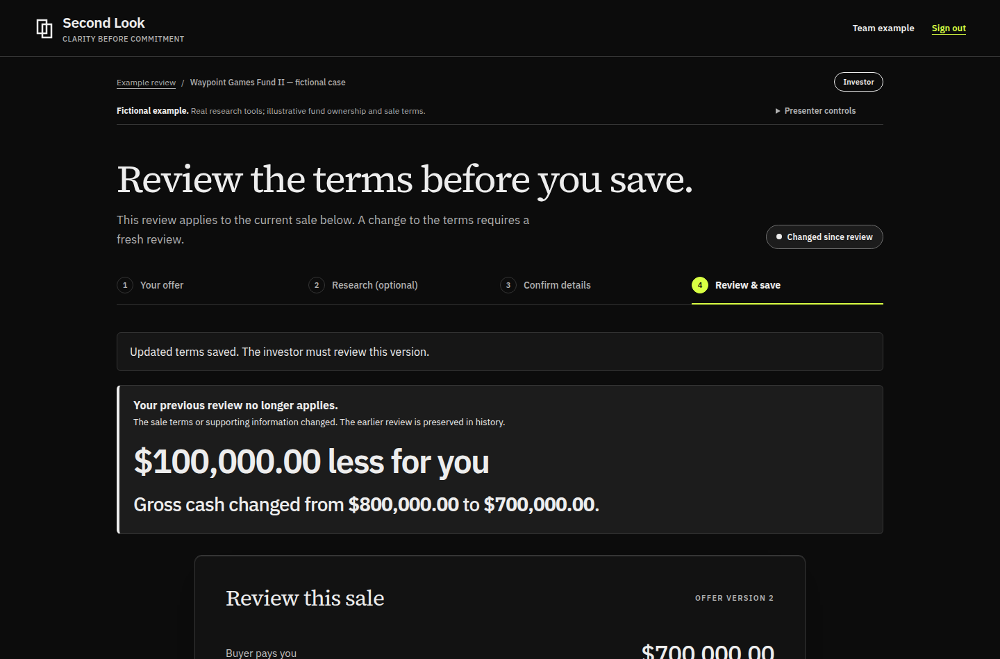

# Final presentation path

Use **Team example** and the team's access code. No individual account is required for the prepared gaming case.

1. **Your offer:** explain the $700,000 purchase payment and the unconfirmed fund payout.
2. **Research (optional):** show one game's player evidence and company profile. These are real saved observations with dates, not a fresh research claim. Select **Draft a question about this game**, then **Use this question**.
3. **Confirm details:** select **Try answering as the fund contact**, **Use the labeled fictional example**, then **Save my answer**. The fund, ownership and $100,000 payout are fictional scenario inputs.
4. Select **See the investor's updated total**. Show the $800,000 gross cash total and select **Save this review**.
5. Select **Try changing the buyer's terms**. Change **Who keeps the fund payout** to the buyer. Save revised sale terms, then select **See the investor's updated total**.
6. Show **$100,000.00 less for you**, the $800,000 to $700,000 comparison, and the previous review marked out of date. Download the review summary if useful.

The key line: "The purchase price did not change. Who gets the payout did. Second Look shows the difference and makes sure the old review is not mistaken for a review of the new terms."

Do not spend the presentation in provider settings, X1 setup, or account registration. Those are not required for this prepared path. Do not describe the example difference as actual customer savings, an investment return or a verified valuation.

## Verification

The public site's saved gaming research, question sharing, fictional fund answer, approval and buyer-revision flow passed on October 24. The follow-up UI adds direct participant transitions, collapses the presenter selector on transition and shows the computed cash difference prominently. 96 tests and the production build passed. The revised path, persisted change, download and 390px layout passed in an isolated local browser. The release receipt separately records post-deployment verification. A timed spoken run on the presenter's laptop is separate from this browser check.

