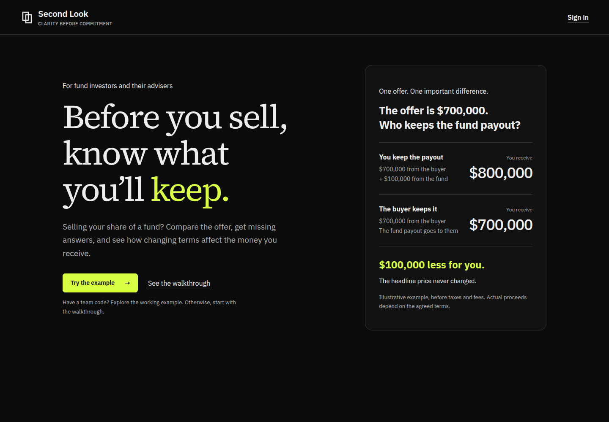

# A clearer first visit

The homepage starts with the investor's question: “Before you sell, know what you'll keep.” A labeled illustrative comparison shows why the same $700,000 offer can yield $800,000 or $700,000 depending on who keeps a $100,000 fund payout. Amounts are before taxes and fees.

“Try the example” opens the existing team-code form. “Sign in” opens account access. Visitors without a code can open the public screenshot walkthrough. No access controls or financial calculations changed.

Verified locally on the release candidate: 96 tests passed, production build passed, desktop at 1440 pixels and phone at 390 pixels inspected, no horizontal overflow, registration form reachable, and the example-code flow reached Your offer. Ryan's script and PDF now name the new starting button.

