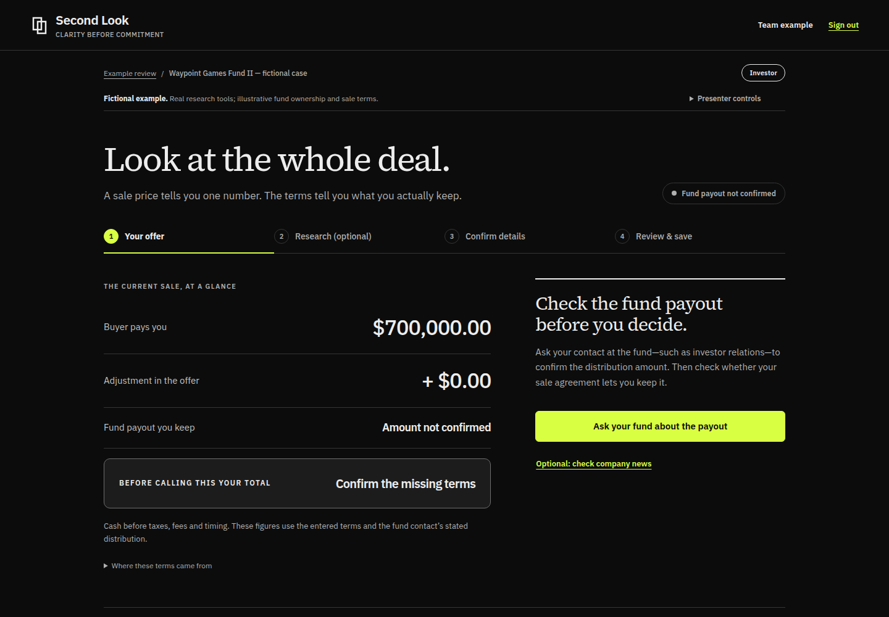
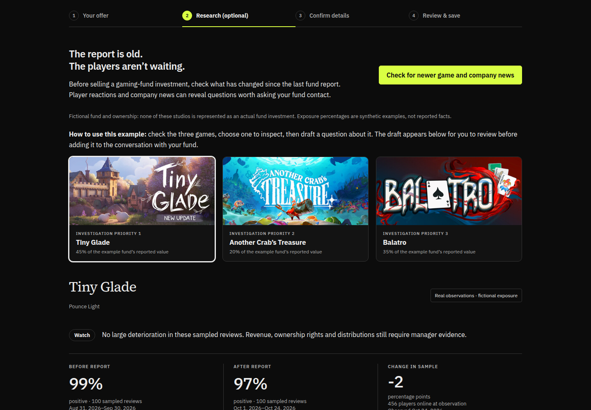
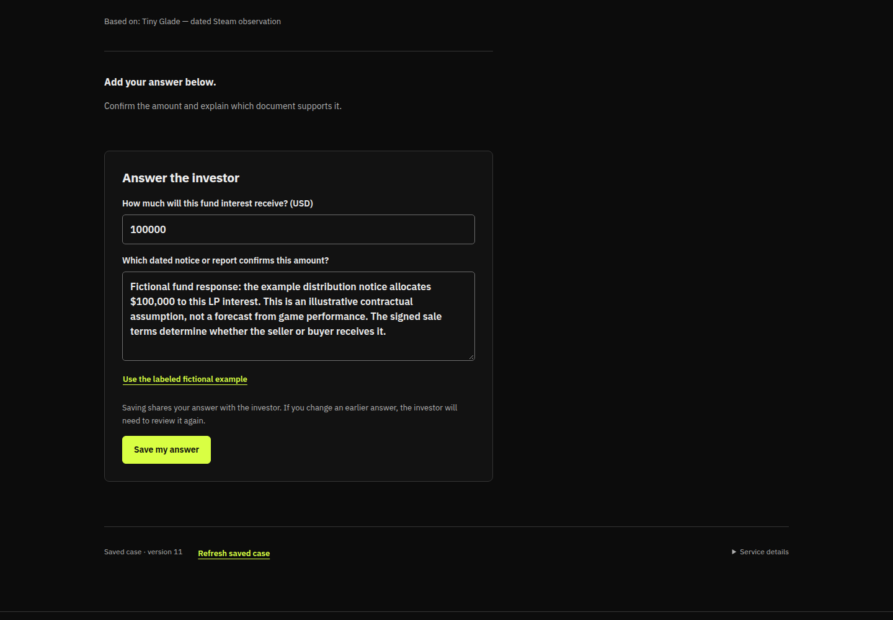
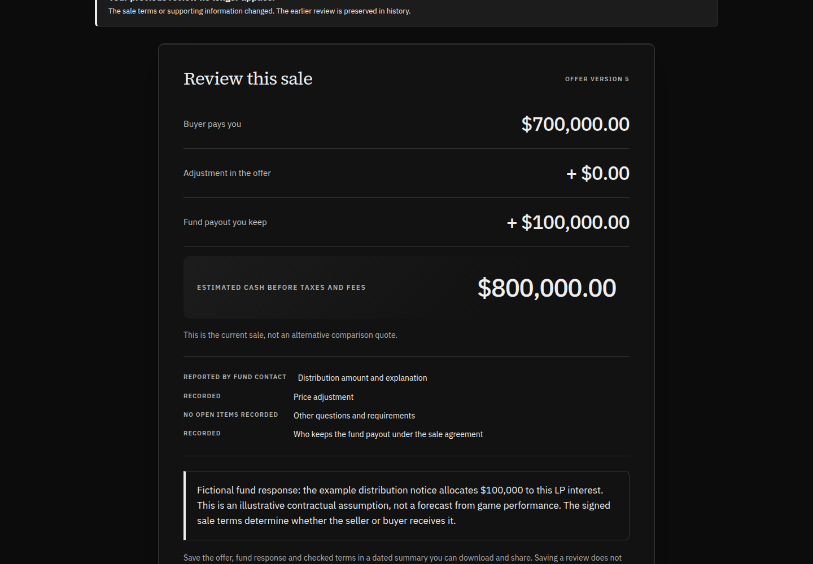
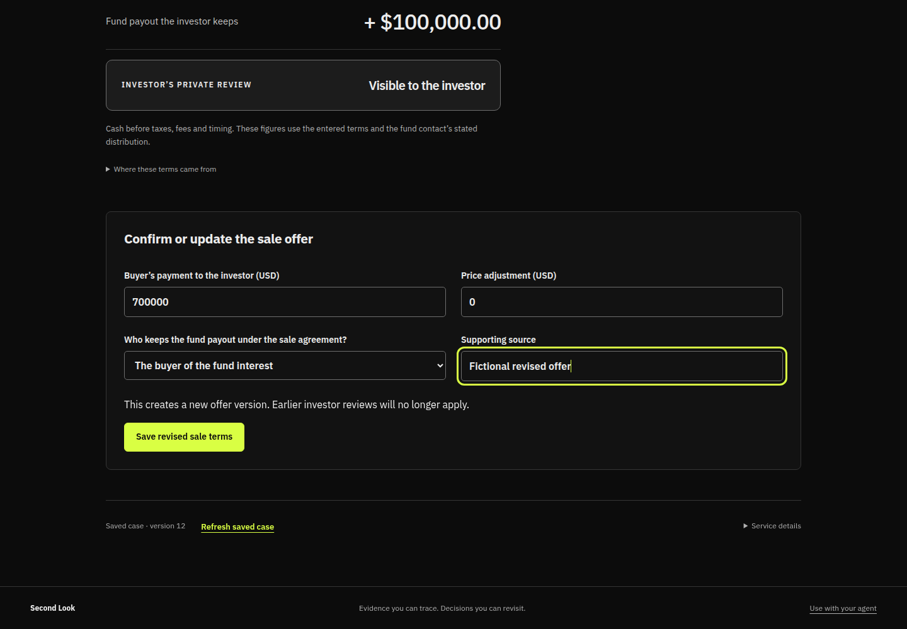
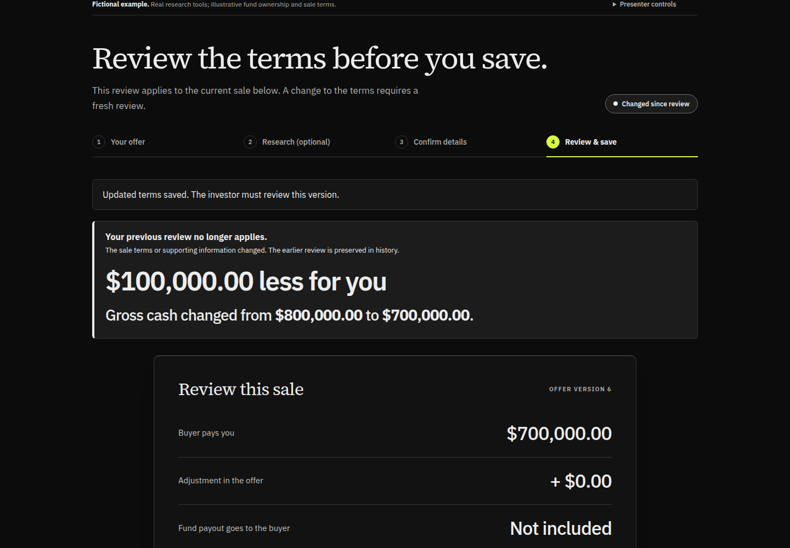

# Ryan’s three-minute Second Look demo

Before the timer starts, open https://secondlook.ac, refresh, choose Team example and enter the team code. Start on Your offer with a $700,000 purchase payment and an unconfirmed fund payout. Read only the Say paragraphs aloud. The screenshots are captured examples, not a live view of the app.

[Open the screenshot presentation](https://secondlook.ac/presenter/) · [Download the PDF](https://secondlook.ac/presenter/second-look-demo.pdf) · [Original product plan](PLAN.md)

## 0:00–0:30 | What will you actually keep?

**Click / show:** Start on Your offer. Point to the $700,000 purchase payment.

**Say:**

> Imagine you invested in a fund that backs video game companies. Someone offers you $700,000 to buy your share. Before you say yes, you need to know what you’re giving up, including any money the fund is about to pay you.

> Second Look helps you work that out. This fund and these dollar amounts are fictional, so we can show you the whole process.

## 0:30–1:00 | Ask a better question

**Click / show:** Click Research (optional). Show Tiny Glade, its player-review numbers and the company information. Click Draft a question about this game. Scroll down and click Use this question.

**Say:**

> We started with gaming because it’s a world I know. A fund report might be weeks old, but players are still reviewing the games and companies are still making news.

> These are real findings we saved earlier. They help us ask the fund better questions, but they don’t tell us what money we’re entitled to receive. For that, we need an answer from the fund.

## 1:00–1:30 | Get the missing answer

**Click / show:** Click Try answering as the fund contact. Scroll to Use the labeled fictional example and click it. Click Save my answer.

**Say:**

> Here I’m showing the person at the fund answering our question. In this example, they confirm that our share is due a $100,000 payout.

> Their answer stays with the question, so the investor can see what was said and use it when reviewing the offer.

## 1:30–1:55 | See the complete amount

**Click / show:** Scroll up and click See the investor’s updated total. Point to $800,000. Scroll down and click Save this review.

**Say:**

> Back on the investor’s side, we can now see the full picture. The buyer pays $700,000, and the current terms let us keep the $100,000 fund payout. That’s $800,000 before taxes and fees.

> I’ll save this review so we have a record of exactly which terms we checked.

## 1:55–2:25 | One term changes

**Click / show:** Click Try changing the buyer’s terms. Under Who keeps the fund payout under the sale agreement?, choose The buyer of the fund interest. In Supporting source, type Fictional revised offer. Click Save revised sale terms. Scroll up and click See the investor’s updated total.

**Say:**

> Now the buyer changes one detail. They still offer $700,000, but the revised agreement says they get the fund payout.

> The headline price looks exactly the same. Let’s see what that change actually means for us.

## 2:25–3:00 | $100,000 less for you

**Click / show:** Point to $100,000.00 less for you and Your previous review no longer applies. Pause for the audience to read. Finish on this screen.

**Say:**

> We now receive $700,000 instead of $800,000. That one change makes a $100,000 difference.

> Second Look shows the difference clearly and flags that our earlier review is out of date. The original review is still there, but we need to look at the new terms before deciding.

> That’s what we’re building for fund investors and their advisers: a way to bring the research, the answers and the changing deal together, so people understand what they’re agreeing to.

## If something is slow

Use the saved research already on the page. Do not start Check for newer game and company news during the three-minute presentation. If the live app is unavailable, open the screenshot presentation and say, “These are screenshots from our working app that we captured earlier.” Do not present the screenshots as live interaction.

## Did our scope drift?

The core story matches PLAN.md: gaming evidence, a question to the fund, its answer, a saved review, then changed sale terms with a visible dollar consequence. We expanded the product with individual accounts, invitations, offer comparisons, funding needs, X1 document connections and agent access. Those are supporting capabilities, not extra scenes for this presentation.

The three-minute story is narrower than the original broad LP Desk idea. It proves one sale-review workflow, not a full family office, automatic fund valuation, investment alpha, transaction execution or a finished enterprise product. Gaming evidence prompts investigation; the fictional fund answer establishes the payout assumption. The app calculates what the stated terms mean.

## Capture and readiness

Screenshots captured from secondlook.ac on October 24, 2026, release a62301b555651e2da159b067282a5028475036de. The live click path, persisted review and changed proceeds passed browser verification. This script targets three minutes but has not been timed aloud on Ryan’s laptop. The shared example can change if someone else rehearses it. Confirm the opening state before recording.
