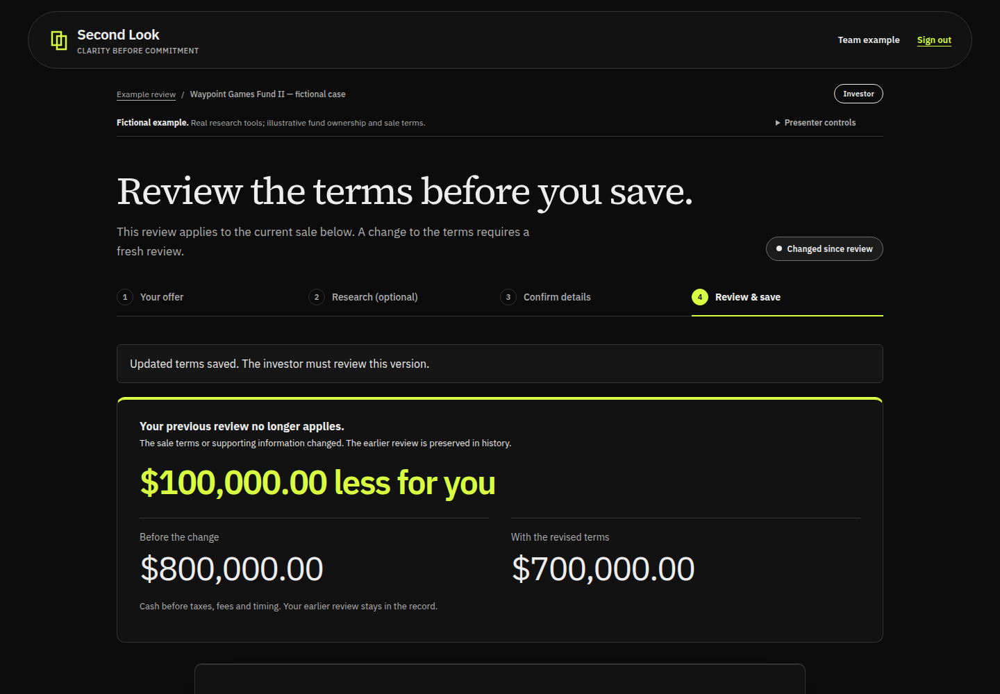
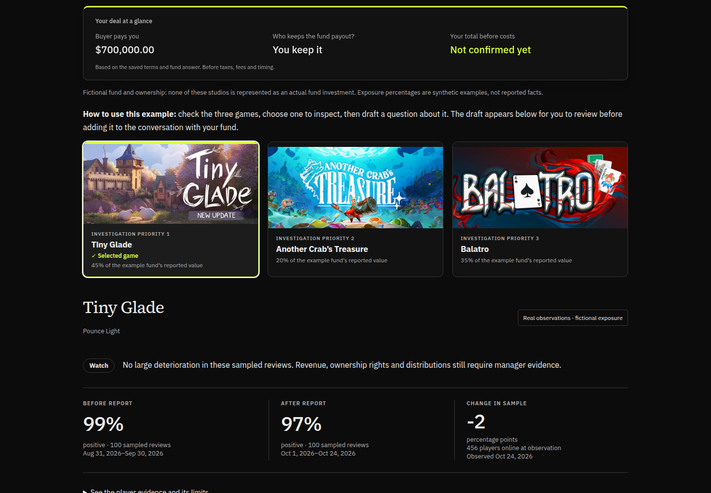

# Ryan's design, integrated with the working demo

Design source: [Ryan's merged UI branch at 8391562](https://github.com/LaiderBrainTrust/Second_Look/tree/83915620fc063fa62fa7c05fa0265a25d1647579). This is a selective adaptation of Ryan's visual work, preserving the current application journey.

| Before | After | Why |
| --- | --- | --- |
| Plain full-width header | Rounded dark header with lime brand accent | Bring Ryan's visual identity into the existing navigation |
| Game selection mainly indicated by border | Lime top edge, border and explicit Selected game checkmark | Make selection clear without relying on color alone |
| Cash change expressed in a sentence | Large labeled before/after figures and prominent dollar difference | Show the consequence immediately |
| Offer context disappears during research | Compact deal summary on research and confirmation pages | Keep research connected to what the investor receives |

The summary uses the saved buyer payment, payout recipient and server-calculated total. Missing totals remain unconfirmed. It is shown only to the investor and is not sticky on phones or short screens. No animated intermediate dollar figures are introduced.

Existing authentication, case URLs, unsaved-edit protection, sponsor calls, account permissions, and presenter buttons remain in place. Ryan's replacement router, login, services pages and scroll-reveal observer were not imported. The three-minute script's button names and order still apply; its screenshots show the earlier visual treatment.

## Validation

- All 96 repository tests and the production build passed.
- Separate local synthetic case: answer, $800,000 total, save review, revise buyer terms, $700,000 total, $100,000 less, reload, and download passed.
- Desktop and 390px phone views inspected. No horizontal overflow. Summary remains static on small screens.
- No live case changes are needed to deploy these visual updates.

